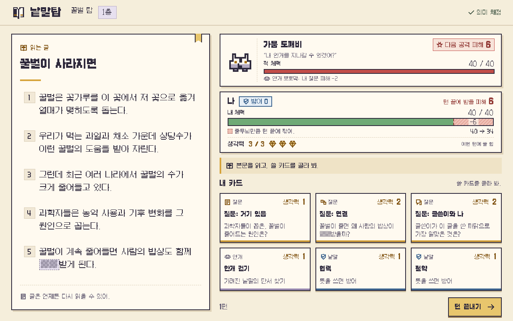
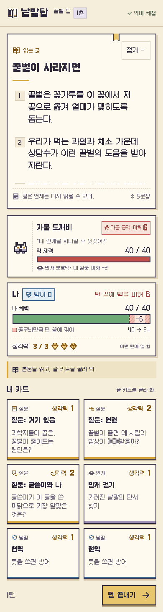
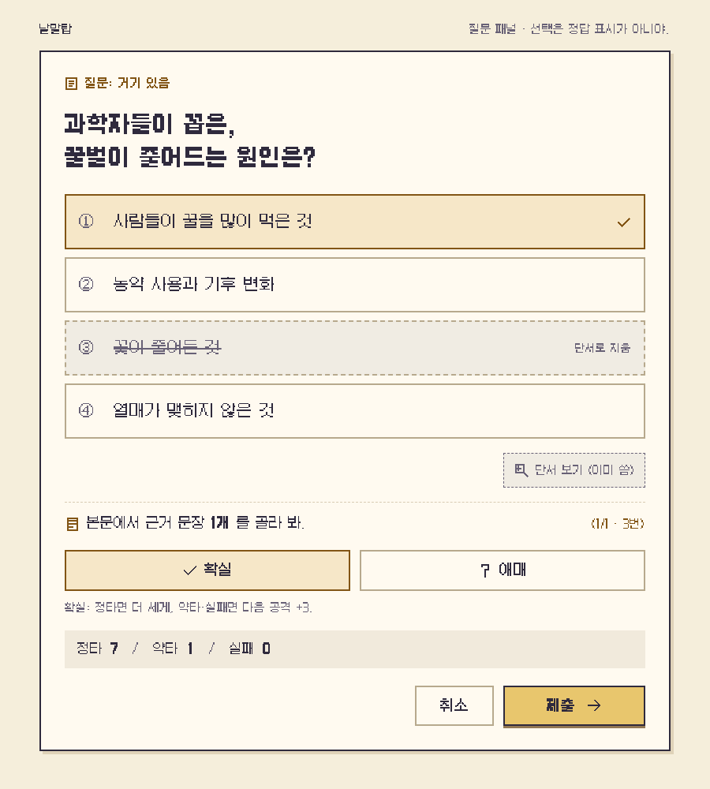

# 낱말탑 디자인 명세 — 종이빛 탐험노트

2026-10-21 갱신 · **제작안 v5: 왕명과 닫힌궁, UI 배치 검토 중** · 구현 대상: 기존 React + 일반 CSS + Galmuri. 게임 코드 반영 전의 디자인 산출물이다.
검토 근거: 사용자가 적은 화면 01~13과 요구사항, `src/ui`·`src/styles`·스토리 설정. v1 제작 당시 스크린샷은 확인되지 않았으며, 이후 main에서 추가된 `current/`의 13장과는 아직 대조하지 않았다.
유지: 기능·본문·문항·행동 순서, 기존 주요 버튼 문구. 새 보조 문구는 설명 제안이며 채점·전투 규칙을 바꾸지 않는다. 1단계 시안을 먼저 표시한 뒤, 같은 방향으로 2단계 아트를 제작했다.

## A. 디자인 방향

**이야기·한국풍 기준:** [왕명·글힘·닫힌궁](../스토리.md)과 [현재 캐릭터·요괴](한국풍-아트-수정안.md). 카드·봉인은 [부적패·호리병·도장·마패](부적패와-호리병-봉인.md), 강화·아이템은 [구상만](성장과-아이템-구상.md) 정리한다. 전체 요청은 [갱신 브리프](GPT-디자인-브리프.md)를 따른다.
**사용자 확정(2026-10-21):** [한국풍 키 아트 v4](concept/key-art-v4-korean.png)와 **현재 검은 머리·현대 한복 캐릭터**를 기준으로 삼는다. 세밀한 도트와 캐릭터 복식은 유지하며 새 도구·연출을 제작했다.
캐릭터·배경을 기존 32×32·48×48에 묶지 않는다. 작은 픽셀 군집·계단 윤곽·단계별 단색 음영으로 세부를 살리며, 최종 게임용 셀 크기는 실제 표시 크기에 맞춰 정한다. 본문 가독성·글꼴·조작 규칙은 유지한다.
한국풍 방향과 현재 캐릭터 디자인을 유지한다. 왕명을 받은 ‘나’가 닫힌궁에서 요괴를 봉인해 사람들의 글힘을 되찾는다. 글힘은 세계관 용어이며 새 자원이 아니다. 아래 v1 시트는 이전 버전이고 실제 화면 연결은 남아 있다.

**콘셉트: 종이빛 탐험노트.** 읽는 글은 펼친 책의 큰 종이, 손패는 탐험 중 붙였다 떼는 가로 쪽지, 적은 여백에 잠깐 나타나는 종이 인형이다. 본문보다 그림·체력·카드가 먼저 소리치지 않게 한다.
무드 키워드 5개: **또렷함 · 포근함 · 호기심 · 손맛 · 작은 성취**.
분위기 참조: 한지 책이 있는 목조 서고, 민화의 익살, 현대 한복의 실용성, 종이 도술과 독서 기록. 특정 작품의 카드 비례·실루엣·상징을 차용하지 않는다.
시선 순서: 본문 제목과 문장 → 적 예고 → 내 체력·방어·생각력 → 사건 → 카드/입력 → 턴 종료. 행동 순서는 현재 컴포넌트를 따른다.
재질은 단색 면·단단한 계단 모서리·짧은 그림자로만 표현한다. 종이 얼룩, 노이즈, 흘러다니는 먼지, 글 위 조명은 사용하지 않는다.
선택은 **금빛 테두리+선택 표식**, 결과는 **정타/약타/실패 글자+각각 다른 아이콘**이다. 제출 전 선택 표시를 정답 색이나 성공 연출로 바꾸지 않는다.

## B. 디자인 토큰

기존 변수 이름을 유지한다. 아래 색은 제안값이며 게임의 `tokens.css`에는 아직 쓰지 않았다.

| 변수 | 값 | 쓰임 |
|---|---|---|
| `--color-bg` | `#f5eedb` | 화면 바탕, 큰 빈 여백 |
| `--color-panel` | `#fffaf0` | 본문·입력·카드의 읽는 면 |
| `--color-ink` | `#2f2a3d` | 본문·아이콘·2px 외곽선 |
| `--color-muted` | `#686176` | 보조 글자. 기존 라벤더를 어둡게 보정 |
| `--color-accent` | `#825515` | 금빛 계열 글자·선택 테두리. 기존 금빛보다 어둡게 |
| `--color-select` | `rgba(214,163,58,.22)` | 정답 여부와 무관한 선택 면 |
| `--color-hp` | `#c34e49` | 적 체력·예상 피해 무늬. 글자와 분리 |
| `--color-block` | `#3c648f` | 방어 배지·활성 방어 외곽선 |
| `--color-good` | `#6faa76` | 내 체력 면. 이 색만으로 성공을 알리지 않음 |
| `--color-weak` | `#845815` | 약타 글자·반쪽 빛 아이콘 |
| `--color-fail` | `#777080` | 실패 글자·닫힌 쪽지 아이콘 |
| `--color-line` / `--color-shadow` | `#d8cbb3` / `#dfd2b8` | 종이 구분선 / 그림자 |
| `--color-gold` / `--color-lavender-surface` | `#d6a33a` / `#e7e0ef` | 장식·보석 면 / 안개 면 |
| `--color-block-surface` / `--color-damage-surface` | `#e7eff6` / `#f0c2b6` | 방어 배지 면 / 피해 예고 면 |

| 토큰 묶음 | 값·용도 |
|---|---|
| 글꼴 | 글꼴: Galmuri11 400·700, Galmuri9 400만 사용. 가짜 굵게·기울임 금지. 체력·개수는 `font-variant-numeric: tabular-nums`. |
| 글자 크기·행간 | 글자 단계: 타이틀 32px, 화면 제목 28px, 본문 제목 24px, 본문 **데스크톱 20px/32px·모바일 18px/29px**, 문항 20px/30px, 버튼·보기 16~18px, 카드 이름 15~16px, 설명 14px/20px, 비용 13~14px+숫자 16~18px, 부가 메타 12~13px. 확대 시안만 문항 28px·보기 20px로 확대한다. |
| 간격 | 간격: `--space-1~7 = 4, 8, 12, 16, 24, 32, 48px`. 패널 사이 12~24px, 본문 안 20~24px, 모바일 바깥 16px·패널 안 12~16px. 아이콘과 글자 사이 6~8px. |
| 테두리·그림자 | 선·그림자: 구조 2px 잉크선, 보조 1px 종이선, 선택 2px 진한 금빛, 키보드 초점 3px 파랑+3px 간격. 종이 `4px 4px 0 #dfd2b8`, 버튼 `0 3px 0 #927854`; 흐림 그림자·광택·그라데이션 없음. 모서리는 직각 또는 2px 계단으로 깎는다. |
| 도트 격자 | 캐릭터·배경은 키 아트 v3의 세밀함을 기준으로 재제작한다. 32×32·48×48은 v1 초안 규격이다. 아이콘 16×16 제안은 유지한다. 새 게임용 시트는 실제 표시 크기를 보고 셀을 정하고, 정수 배율+`image-rendering: pixelated`를 쓴다. 글자에는 도트 확대 필터를 씌우지 않는다. |

계산한 대비: 패널 위 잉크 **13.28:1**, 보조 글자 **5.67:1**, 강조 글자 **6.19:1**, 방어 글자/옅은 파랑 **5.30:1**. 작은 글자 목표 4.5:1 이상. 바 색에는 숫자·배지·무늬를 함께 쓴다.

## C. 컴포넌트 명세

상태 공통: 기본=종이 면/잉크선, 눌림=2px 아래(동작 줄이기 때 정지), 선택=금빛선+표식+`aria-pressed/checked`, 꺼짐=옅은 종이+점선+사유(전체를 흐리게 하지 않음), 결과=제출 뒤에만 결과 아이콘·단어. 모든 **보이는 조작 대상은 최소 44×44px**다.

| 컴포넌트 | 모양·크기·간격·아이콘 | 상태와 동작 |
|---|---|---|
| 질문 3종 카드 | 가로 한지 부적패 약 216×112px, 모바일 2열 폭 170px 전후·내용만큼 높이. 문서/두 쪽 연결/말풍선 아이콘 | 순서 ‘거기 있음→연결→글쓴이와 나’ 유지. 같은 금빛 테두리·크기·종이 면. 다시 보기는 글자 배지 |
| 안개 걷기 카드 | 같은 쪽지 크기, 안개 선 아이콘·라벤더 밑줄 | 성공 전 유지, 실패한 턴은 잠금 표식+‘다음 턴에’. 낱말의 뜻이나 정답 근거를 그림에 넣지 않음 |
| 요약 봉인 카드 | 같은 부적패 크기, 호리병·도장 아이콘·금빛 보조선 | 해금 순간 ‘요약 봉인’ 글자와 정적 표식. 성공 도장은 요약 채점 후에만 표시 |
| 낱말 카드 | 같은 크기, 방패 아이콘·파란 밑줄, 낱말 제목 | 뜻 쓰기 패널로 연결. 공격 카드처럼 읽히지 않게 ‘뜻을 쓰면 방어’ 유지 |
| 카드 비용 | 오른쪽 위 **‘생각력 1’**. 이름과 별도 줄, 숫자만 원형 장식에 숨기지 않음 | 부족하면 비용 옆 빈 마패 표식+‘생각력 부족’. 소모량을 정답 여부로 미리 바꾸지 않음 |
| 생각력 | ‘생각력 3 / 3’+마패풍 표식 3개, 20~24px 아이콘·6px 간격 | 남음=금빛 채움+말 무늬, 소모=빈 외곽선. ‘이번 턴에 쓸 힘’은 초반 보조 설명. 새 자원이 아님 |
| 적 체력·예고 | 인형은 정보 바깥 64~96px. 이름→등장 대사→적 체력 숫자/14px 바. 예고는 이름 옆 **‘다음 공격 피해 6’** | 예고는 붉은 톱니 충격 아이콘+숫자, 무기 아이콘 사용 안 함. 확신 벌 포함한 실제 예정값. 전투 종료 시 예고 숨김 |
| 내 체력·예상 피해 | 내 체력 숫자+24px 바. 남을 부분 세이지, 잃을 부분 계단 줄무늬·점선 경계+`−6`. 옆/아래 **‘턴 끝에 받을 피해 6’, ‘40 → 34’** | 바 안 숫자가 안 들어가는 작은 피해는 아래 설명에 표시. 피해는 현재 체력까지 잘라 그리되 실제 예정 피해 숫자는 보존. 0이면 ‘이번 턴 받을 피해 0’ |
| 방어 | 파란 방패+**‘방어 5’** 사각 배지, 활성일 때 내 패널 파란 보조 외곽선 | 0이면 얇은 비활성 배지. 체력 위에 방어를 별도 체력처럼 더하지 않음. 피해와 다른 모양·위치·문구 |
| 안개 보호막 | 안개 아이콘+‘안개 보호막: 내 질문 피해 −2’, 얇은 라벤더 띠 | 켜짐/해제 글자. 적 체력 위에 추가 체력처럼 채우지 않음 |
| 본문·근거 | 번호 28px+문장. 평소는 투명 면, 선택 때 금빛 테두리+짙은 번호칸+체크·‘선택됨’ 접근성 이름 | 정답 근거는 미리 표시하지 않음. 선택 해제는 같은 문장 다시 누르기. 제한 개수는 현행 규칙. 입력 비활성 때도 본문 글자 대비 유지 |
| 가려진 낱말 | `▒▒`를 라벤더 점선 상자에, 줄 높이 안에서 표시 | 해제 뒤 원문 복원. 글자 수로 정답을 암시하지 않고 기존 동일 표기 유지 |
| 보기 4개 | 각 100% 폭, 같은 최소 높이 64px(모바일 줄바꿈에 따라 네 개 모두 같은 높이), 번호+문구+고정 표식 자리 | 선택 표식은 모두 동일. 단서로 지운 항목만 취소선+‘단서로 지움’+사용 불가. 결과 전 정답 강조 없음 |
| 단서·근거 안내 | 보기 아래 단서 보기 44px 버튼→‘본문에서 근거 N개…(k/N·번호)’ 순서 유지 | 사용 비용/공짜/이미 씀 명시. 부족 사유 표시. 개수 채움은 진행 표시이지 정답 표시가 아님 |
| 확신·미리보기·제출 | 확실/애매 동일 2열 52px, 체크/물음표 아이콘. 범위 ‘정타 7 / 약타 1 / 실패 0’. 취소→제출 | ‘확실’ 선택은 성공 색 아님. 실제 현재 맥락으로 계산. 제출 전 빠진 조건을 한 줄 안내. author 낱말 붙이기는 기존 위치 유지 |
| 낱말·요약 입력 | 제목→지시문→입력→예문/글자 수→취소·제출 순서. 한 줄 입력 52px, 요약 3줄 108px, 글자 18px | 라벨은 placeholder와 분리. 한글 조합 중 Enter 제출 금지. 채점 중 중복 클릭 방지·‘채점 중…’. 요약은 공백 제외 10~60자 안내 |
| 입력 결과·뜻 가까움 | 내 답→실패 이유→정답 뜻→뜻 가까움→계속. 막대 12px+글자 라벨 | 낱말 정답 뜻은 실패 후에만. 뜻 가까움은 정답률/성적이 아닌 의미 비교임을 보조 설명. 요약은 빠진 개념 안내, 다음 턴 재도전 |
| 사건 알림 줄 | 금빛 왼쪽 책등 선, 40px 이상, 아이콘+기존 사건 문구 | `role=status`, 이전 문구는 짧게 쌓되 본문·입력의 스크롤 위치를 갑자기 움직이지 않음 |
| 승리·패배·보상 | 전투 영역 안 종이 패널 440~560px, 모바일 전체 폭. 버튼 48px 이상 | 본문 위 전체 덮개로 가리지 않음. 승리는 ‘봉인’, 패배는 기존 문구. 보상은 현재처럼 별도 화면 |
| 채점 배지 | 상단 오른쪽 12~14px, 준비=점선 보석+퍼센트, 간이=빈 보석+글자, 완료=체크+글자 | 클릭 요소 아님. 진행 퍼센트는 조용히 갱신, 매 변화마다 읽어 주지 않음. ‘간이’는 학생 실패 표시가 아님 |
| 버튼·초점 | 기본 48px 높이, 주 행동 금빛 면·잉크 글자. 위험·취소는 종이 면 | hover는 마우스에만, 클릭·키보드·터치 동일 기능. 포커스 3px 파랑. 애매/다시 도전하기를 벌처럼 꾸미지 않음 |

## D. 화면별 배치

1280×800: 상단 64px, 바깥 28px, 본문 약 496px / 간격 24px / 전투 704px. 적→나→사건→손패 또는 패널→턴 끝내기의 순서를 유지한다. 본문은 읽기 좋게 남겨 두고 오른쪽 긴 패널만 필요할 때 페이지 스크롤한다.
390px: 바깥 16px, 본문→적→나→사건→카드/패널→턴 종료. 본문은 상단 접기/펼치기 패널; 첫 입장은 펼침, 본문 목록은 최대 236px 높이로 위아래 읽기·‘↕ 5문장’ 안내. 접은 뒤에도 제목과 펼치기 버튼이 남고, 패널은 스크롤 중 상단 8px에 유지된다. 근거 선택 시 본문을 열고 선택 위치를 유지한다.
키보드가 열리면 `100dvh`와 `visualViewport`를 고려해 입력과 제출이 가려지지 않게 스크롤한다. 도킹 본문과 입력이 겹치면 사용자가 접을 수 있으며, 자동으로 답·근거를 바꾸지 않는다. 200% 확대에서는 높이 제한을 풀어 페이지 흐름으로 읽는다.

| 화면 | 1280×800 | 390px / 이유 |
|---|---|---|
| 01 타이틀 | 중앙 560px 종이, 이어하기→탑 목록. 책장 계단 그림은 오른쪽 빈 공간 | 위 제목→이어하기→탑 목록. 저장 경고는 해당 버튼 바로 아래 |
| 02 탑 소개 | 중앙 종이, 탑 이름→왕명·닫힌궁을 담은 두 줄→‘1층으로’ | 같은 순서 1열. 별도 왕 알현 화면은 추가하지 않음. 그림은 문장 아래 |
| 03 전투 시작 | 왼쪽 글, 오른쪽 적 대사→적·나 상태→카드 | 본문을 먼저 읽고 아래 전투 확인. 대사는 1줄, 자동 사라짐에 의존하지 않음 |
| 04 질문 | 손패 자리에 패널. 보기→단서→근거→붙이기(있을 때)→확신→범위→제출 | 같은 순서. 본문 접기 가능, N개 선택 상태를 패널·번호에 동시 표시 |
| 05 정타 뒤 | 적 바 변화+‘정타’ 사건. 본문 고정·다음 카드 자리 유지 | 숫자·단어로 결과 확인. 화면 흔들기·자동 상하 이동 금지 |
| 06 낱말 입력 | 손패 자리 입력 종이, 본문 계속 노출 | 입력 18px·52px, 라벨 유지. 키보드 때문에 본문을 삭제하지 않음 |
| 07 낱말 실패 | 같은 자리 이유·내 답·정답 뜻·뜻 가까움·계속 | 순차 1열. 실패 색을 온 화면에 깔지 않고 읽을 정보 우선 |
| 08 안개 걷기 | 본문 문장 1개 선택, 패널은 해당 문장 번호와 제출 | 본문 열어 두기, ‘고른 문장: N번’이 아래에도 보여 문맥 유지 |
| 09 요약 카드 등장 | 기존 카드 뒤 현행 순서에 추가, 호리병+‘요약 봉인’ | 2열 그리드의 다음 칸. 다른 카드를 밀어 튀게 하지 않음 |
| 10 요약 입력 | 본문+한 문장 입력·공백 제외 글자 수·제출 | 3줄 입력, 글자 수 바로 아래. 키보드 위 제출까지 스크롤 가능 |
| 11 층 봉인 승리 | 전투 영역 종이에 봉인 대사→봉인 완료→보상 받기 | 닫힌 호리병은 위, 같은 문구 순서. 본문은 위에서 다시 읽기 가능 |
| 12 층 보상 | 중앙 종이: 얻은 카드→체력 회복 숫자→총 카드 수→다음 층 | 같은 순서 1열. `+10`은 실제 회복량이 10일 때만, 최대 체력이면 실제값 |
| 13 모바일 전투 | 데스크톱 배치의 같은 데이터 상태 | 위 도킹 본문·1열 상태·2열 카드. 가로 넘침 없이 전체 문구 줄바꿈 |
| 14 탑 완료 | 해당 화제의 왕명 완료 두 줄→모은 낱말 목록→남은 체력→처음으로 | 목록은 길어지면 세로로. 한 탑 완료를 나라 전체 사건의 해결로 표시하지 않음 |
| 15 패배 | 전투 영역 안 ‘쓰러졌어. 이 층부터 다시 도전해 봐.’→재도전 | 큰 재도전 버튼. 붉은 전체 화면·기록 소실 암시 금지 |
| 16 내 기록 | 5줄 영역·정답률·약점 표시→판단력→결과 코드 복사 | 한 줄당 이름·분수·퍼센트·약점 단어. 데이터 부족은 빈칸 대신 ‘기록이 더 필요해’ |
| 17 교사 | 코드 입력→분석 행동→학급 표. 상단에 저장 안 함 안내 | 폼 1열, 넓은 표만 가로 스크롤·이름 열 고정. 설명은 존댓말 |
| 18 채점 배지 | 전 화면 헤더 오른쪽, 경고창처럼 크지 않음 | 로고·탑 옆 오른쪽. 긴 준비 문구는 다음 줄, 본문 폭은 침범하지 않음 |

## E. 연출

반복 행동은 150ms 이하 색/테두리 전환만. 모든 연출은 숫자·단어·고정 표식으로도 결과가 남는다. `prefers-reduced-motion: reduce`면 이동·확대·루프·깜박임·자동 스크롤·진동을 모두 끄고 아래 대체를 즉시 표시한다. 색상 전환도 즉시 처리한다.

| 사건 | 기본 연출 / 길이 | 움직임 줄이기 |
|---|---|---|
| 정타 | 선택 근거의 빛나는 짧은 선→적 가장자리 작은 쪽지 / 360ms | ‘정타·피해 N’+바 수치 즉시 변경 |
| 약타 | 선이 반 길이로 접힘 / 240ms | 반쪽 빛 아이콘+‘약타·피해 N’ |
| 실패 | 카드 표식이 접힌 빈 쪽지로 / 160ms | ‘실패·피해 0’+이유. 보기의 틀림 표시는 제출 뒤에만 |
| 방어 발동 | 카드가 작은 부채로 펴짐→파란 배지 `+5` / 280ms | 방패+‘방어 +5’, 받을 피해 수치 즉시 갱신 |
| 적 공격 | 먼지 고리/종이 끈/망토가 프레임 안에서 움직임 / 320ms | ‘공격 N−방어 M=받은 피해 K’ 사건, 새 체력 수치 |
| 안개 걷힘 | 가린 상자가 2~3개의 종이 조각으로 열림 / 300ms | 원문+‘안개 보호막 해제’, 낱말 획득 예정 표시 |
| 요약 봉인 | 성공 확정 뒤 부적 펼치기→접힌 안개가 호리병으로→마개·도장 / 720ms | 닫힌 호리병 정지 그림+‘봉인 성공!’·봉인 대사 |
| 패배 | 내가 무릎을 굽히고 카드 내려놓기 / 300ms | 패배 정지 포즈+기존 재도전 문구·버튼 |

## F. 스프라이트·아트 목록

아래 캐릭터 PNG의 크기·색 수는 **기존 v1 초안 파일의 기록**이다. 새 기준은 현재 한복 주인공과 먹안개 도깨비(`dokkaebi`)·뒤섞는 호랑이(`tiger`)·헛소문 여우(`fox`)다. 새 셀·적 이름·id·대사는 스토리 6장의 표로 후속 연결하며 현재 게임 데이터는 바꾸지 않았다.

인물마다 잉크 외곽선 외에 본색 2~3개, 배경 알파 0. 얼굴 디테일은 최소, 총알·피·상처·칼날·주먹 타격은 없다. 작은 그림의 구분은 색 대신 실루엣으로도 한다.

| 이름/파일 | 논리 크기·색 수 | 필요한 프레임·형태 |
|---|---|---|
| `reader.png` | 32×32/프레임, 잉크+세이지·크림·금빛 | 오른쪽 옆앞모습. 대기/부채 방어/근거 가리키기/패배 4포즈. 4열 시트·논리 128×32 |
| `drought.png` | 32×32, 잉크+크림·라벤더·금빛 | 왼쪽 보기. 낮은 둥근 덩어리·중앙 틈·둥근 귀. 대기/먼지 고리/봉인 1·2·3의 5열 시트 |
| `bloomgap.png` | 32×32, 잉크+세이지·크림·라벤더 | 빈 원형 꽃 고리·안개 꼬리·말린 끈. 대기/끈 공격/봉인 1·2·3의 5열 시트. 가운데 구멍은 6논리 px 이상 |
| `erasure.png` | 48×48, 잉크+라벤더·크림·금빛 | 넓은 망토·접힌 왕관·원/네모/세모 창. 대기/망토 펼침/봉인 1·2·3의 5열 시트 |
| 카드 틀 6종 | 104×56 기준, 잉크+종이+종류색 1개 | 가로 쪽지. 거기 있음/연결/글쓴이와 나/안개/요약/낱말. 비용·아이콘·글자 자리는 비움. 모서리만 9-slice, 글자는 HTML |
| 아이콘 12종 | 16×16, 잉크+역할색 최대 1개 | 생각력/피해/방어/보호막/근거/단서/확실/애매/책갈피/정타/약타/실패. 공격은 충격 별, 실패는 접힌 빈 쪽지 |
| 키 아트 | 한국풍 수정안 v4: 1672×941 PNG, 세밀한 도트 | 목조 서고·책장 계단·검은 현대 한복과 용 문양·도깨비/호랑이/여우. 이전 v3와 384×216 정수 격자 초안은 보존 |
| 완성 전투 시안 | 1280×800 | 확정 배치에 위 아트 합성, 한국어는 Galmuri로 렌더링. 그림 생성 모델에게 한글 조판을 맡기지 않음 |

2단계 저장: 캐릭터 시트와 같은 이름 `.prompt.txt`는 `src/ui/sprites/`; 키 아트·카드·아이콘·완성 시안과 각 프롬프트는 `docs/design/concept/`. 투명이 안 되면 `#ff00ff` 단색 대체를 명시한다. 체크무늬를 그림으로 굽지 않는다.
납품 검사: PNG 실제 RGBA·알파의 0 픽셀 존재, 실루엣 밖 불필요한 흰 테두리 없음, 셀 경계 겹침 없음, 정수 확대. AI 컨셉 원본은 논리 격자와 다를 수 있어 원본/격자 정리본을 구분하고 런타임 투입 전 별도 검수한다.

## G. 헷갈림과 해결 / 전체 검토

full 검토 범위: React 화면·일반 CSS·사용자 제공 화면 설명. 아래 Before는 코드와 사용자 지적 근거이며 첨부 사진 직접 검토가 아니다. 실제 게임에 적용한 변경이 아니라 설계·시안 제안이다.

| 심각도 | 위치 | Before | After | 아이에게 필요한 이유 |
|---|---|---|---|---|
| HIGH | Hand·모든 비용 | 작은 구석 숫자/작은 임시 글자 | ‘생각력 N’+보석과 같은 단어·큰 수치 | 카드 비용을 낱말 번호로 오해하지 않음 |
| HIGH | BattleBars·공격 | 무기 아이콘과 숫자만으로 피해를 추측 | ‘다음 공격 피해 N’+충격 별 | 공격 방향·뜻이 분명함 |
| HIGH | BattleBars·내 체력 | 줄무늬가 방어처럼 보임 | 줄무늬+‘−N’+‘현재→예상’+턴 끝에 받을 피해 | 미래 체력 감소와 방어를 분리 |
| HIGH | BattleBars·방어 | 체력바와 섞여 해석 | 파란 방패 배지·활성 외곽선·‘방어 N’ | 색을 못 구분해도 위치·단어·모양으로 이해 |
| HIGH | PassagePanel | 작은 비활성 글자·선택 색 의존 가능 | 20/18px 고대비·번호 반전·테두리·선택 표식 | 본문이 가장 편하고 근거가 또렷함 |
| HIGH | QuestionPanel | 선택·정답 상태 혼동 가능 | 모든 보기 동일 크기·선택 표시, 결과는 제출 뒤 | 정답 암시 방지 |
| MEDIUM | QuestionPanel·확신 | ‘확실’이 정답 확인처럼 보임 | 체크/물음표·동등한 두 버튼·규칙 짧게 | 확신은 베팅 선택이라는 뜻 전달 |
| MEDIUM | 390px | 본문이 길어 전투 위치를 놓침 | 접기·펼치기 도킹 종이·읽기 영역·문장 수 | 원문과 행동 사이 이동 부담 감소 |
| MEDIUM | WordPanel·미터 | 뜻 가까움이 정답률처럼 보임 | 명칭 유지+의미 비교라는 짧은 안내 | 막대 길이를 점수로 오해하지 않음 |
| MEDIUM | 채점 배지 | 간이가 학생 실수처럼 보일 수 있음 | 상태 모양·단어만 조용히, 실패 빨강 안 씀 | 준비 상태와 학습 결과를 구별 |
| MEDIUM | 화면 전반 | 짧은 클릭 대상·키보드 초점 부족 가능 | 44px 이상·3px 초점·IME·읽기 대비 보존 | 터치와 키보드 모두 조작 가능 |
| MEDIUM | 적·승패 | 공격·처치가 폭력적으로 읽힐 여지 | 종이 동작·봉인·정지 대체 | 정서 부담을 줄이고 게임 장치 설명 |

| 검토 분류 | 확인 근거 | 범위·결과 |
|---|---|---|
| Typography | 실제 Galmuri woff2·3종 렌더·대비 계산 | 본문/숫자/보기 확인. 실기기 장시간 가독성은 미검증 |
| Surfaces | 2개 폭의 PNG·카드/본문/상태 | 넘침·터치 크기·본문 접기 점검 |
| Animations | 위 E의 시간·줄이기 규칙, 시안 CSS | 움직임 줄이기 구현 경로 확인. 실제 게임 10% 속도 연출 검토는 적용 후 필요 |
| Icons | 시안의 직접 그린 픽셀형 SVG·F의 PNG 규격 | 뜻+글자 병기 확인. 2단계 PNG·격자 정리본의 알파/색 수 확인 |
| Performance | 일반 CSS·로컬 폰트·정지 시안 | 새 라이브러리·연속 애니메이션 없음. 기기 프레임률은 미검증 |

검토 후 제외: 카드의 부채꼴 겹침(터치·문구 가림), 체력 위 독립 방어 막대(추가 체력 오해), 정답 보기만 빛남(제출 전 암시), 전투 화면 흔들림(읽기 방해). 실제 후보만 기록했다.

## 1단계 시안과 검증

원본: [preview.html](concept/preview.html), [기본 CSS](concept/preview.css)·[반응형 CSS](concept/preview-responsive.css), [JS](concept/preview.js). 로컬 저장소의 Galmuri 경로를 사용하므로 폴더 구조를 유지하거나 Vite로 열어 본다. 실제 게임이 아닌 검토용이며 본문 접기·보기/확신 선택만 시연한다.
검증 기록은 `concept/layout-audit.json`. PNG 원본 크기·폰트 로드·가로 넘침·보이는 버튼 44px·본문 접기·보기 선택·단서 항목 비활성을 확인한다. 아트는 배치용 간단한 실루엣이며 2단계의 최종 스프라이트가 아니다.
판정: **1단계 검토 가능 / 제품 적용 승인 아님**. 첨부 스크린샷 대조, 실기기 터치·화면 키보드, 200% 확대, 스크린리더와 게임 연출은 적용 단계에서 확인해야 한다. 게임의 검사 결과와 디자인 시안 검수를 구분한다.
2단계는 1단계에서 보여 준 종이빛 방향·가로 카드·본문 도킹·피해/방어 구분을 따른다. 생성 원본과 정리본을 아래에서 구분한다. 실제 게임에 적용한 상태는 아니다.

## 2단계 v1 제작 결과와 인계

기본 `image_gen`으로 캐릭터·카드·아이콘·키 아트 컨셉을 각각 생성했다. 정확한 격자·색 수·봉인 프레임은 같은 콘셉트를 참고한 **신규 코드 픽셀맵**으로 정리했다. 생성 원본을 몰래 리사이즈하거나 색 보정한 파일로 표시하지 않는다. 원본은 `concept/generated/`, 재생성 소스는 `concept/source/`에 있다.

| 묶음 | 큰 미리보기 / 최종 파일 |
|---|---|
| 1 키 아트 | **[한국풍 수정안 v4](concept/key-art-v4-korean.png)** · [세밀도 기준 v3](concept/key-art-v3.png) · [정수 격자 초안](concept/key-art-pixel.png)·[생성 초안](concept/key-art.png) |
| 2 나 4포즈 | [확대 시트](concept/reader-sheet.png) · [128×32 PNG](../../src/ui/sprites/reader.png) |
| 3 가뭄 도깨비 | [확대 시트](concept/drought-sheet.png) · [160×32 PNG](../../src/ui/sprites/drought.png) |
| 4 빈꽃 도깨비 | [확대 시트](concept/bloomgap-sheet.png) · [160×32 PNG](../../src/ui/sprites/bloomgap.png) |
| 5 지움 안개왕 | [확대 시트](concept/erasure-sheet.png) · [240×48 PNG](../../src/ui/sprites/erasure.png) |
| 6 카드 6종 | [확대 시트](concept/card-frames-preview.png) · [104×56 개별 PNG](concept/cards/) |
| 7 아이콘 12종 | [확대 시트](concept/icons-preview.png) · [16×16 개별 PNG](concept/icons/) |
| 8 전투 완성 | [1280×800 완성 PNG](concept/battle-final.png) · [실제 PNG 적용 HTML](concept/preview.html?art=1) |

모든 이미지 옆 `.prompt.txt`에 실제 생성 프롬프트와 정리본 제작 방식을 함께 보관했다. 캐릭터 프레임 순서·좌표는 `src/ui/sprites/frames.json`. 저장소 루트에서 `node docs/design/concept/source/characters.mjs`, `ui-assets.mjs`, `key-art.mjs`를 같은 순서로 실행하면 정리본을 다시 만들 수 있다(이미 설치된 sharp 사용, 새 의존성 없음).
검증: 게임 테스트 **109개 통과**, 타입 검사·Vite 빌드 통과. 세 1단계 시안과 완성 화면은 폰트 로드·가로 넘침 없음·44px 미만 보이는 버튼 없음·본문 접기/보기·확신 선택을 확인했다. 캐릭터는 RGBA·알파0/255·잉크 포함 정확히4색이며 꽃 고리와 보스 창의 구멍도 알파0이다. `image-audit.json`, `sprite-audit.json`, `ui-asset-audit.json`, `final-layout-audit.json`을 함께 보관한다.
현재 게임 코드·엔진·채점·본문 데이터는 수정하지 않았다. 실기기 화면 키보드·스크린리더·200% 확대·실제 게임 연출 검증과 연결은 구현 단계에서 한다. 추가된 `current/`의 스크린샷 13장과 시안의 차이 대조도 남아 있다.
