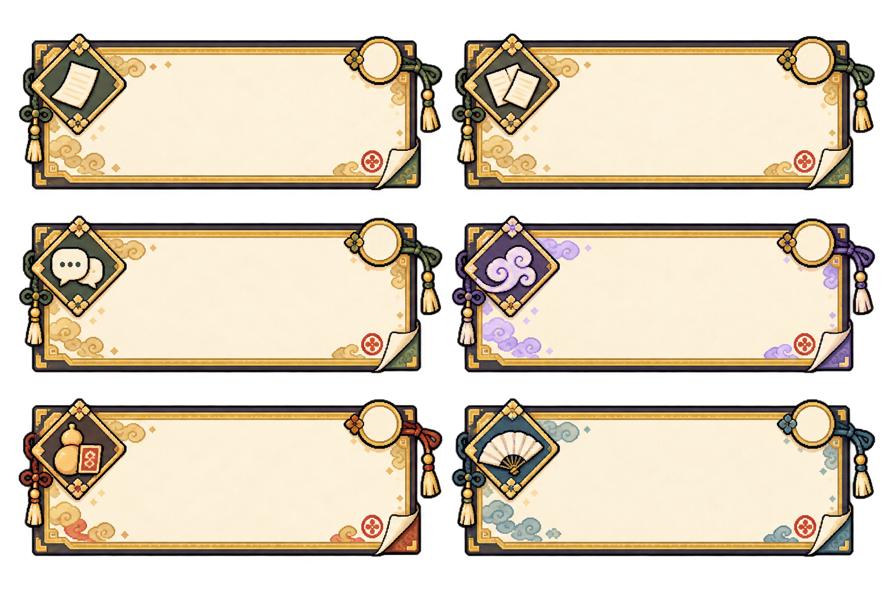
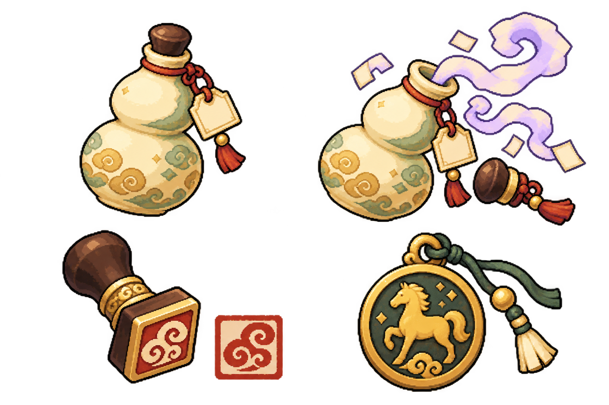
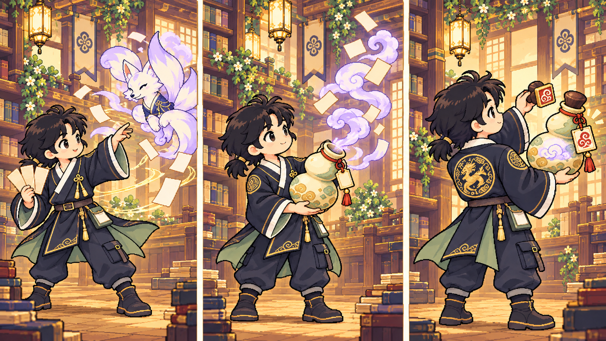

# 한지 부적패와 호리병 봉인 — 도구·연출 수정안

2026-10-21 · 한국풍 서고탑과 현재 주인공 복식은 유지하고, 카드·생각력 표식·봉인 도구를 같은 세계관으로 잇는다.
사용자가 제시한 전우치의 도술 분위기는 손목·소매·종이의 경쾌한 움직임에 참고한다. 검은 머리·겹깃 재킷·용 문양·카고 주머니·신발은 승인된 캐릭터 디자인을 따른다.
전체 줄거리는 [왕명·글힘·닫힌궁](../스토리.md)을 따른다. 질문·근거·낱말·요약·비용과 행동 문구는 유지하고, 이야기 대사·탑 문구는 새 설정으로 후속 연결한다. 도구는 기존 행동을 설명하는 외형이다.

## 역할 구분

| 게임에서 하는 일 | 한국풍 외형 | 학생이 보는 뜻 |
|---|---|---|
| 질문·안개 걷기·낱말·요약 카드 | 글을 적는 한지 부적패 | 어떤 행동을 할지 고르는 카드 |
| 생각력 3 / 3 | 말 무늬가 있는 마패풍 표식 3개 | 이번 턴에 남은 생각력. 기존 ‘생각력’ 글자와 숫자를 함께 표시 |
| 요약 성공 확정 | 나무 손잡이의 네모 도장 | 내 말로 묶은 요약을 확정하는 마지막 동작 |
| 적의 봉인 | 안개를 담는 둥근 호리병 | 종이처럼 접힌 안개가 안전하게 모이는 곳 |

마패를 새 화폐나 아이템 규칙으로 추가하지 않는다. 도장은 요약 정답을 미리 알려 주는 장치가 아니다. 성공 도장은 채점 결과가 확정된 뒤에만 찍는다.
왕명이 담긴 마패는 평소 닫힌 궁에 들어갈 자격을 나타낸다. 생각력 표식 3개는 같은 문양을 빌린 UI이며 입장권을 세 번 소비하는 뜻이 아니다. 강화·아이템은 [별도 구상](성장과-아이템-구상.md)으로만 검토한다.
적은 낱말을 가리는 허구의 종이·안개다. 실제 동물을 다치게 하거나 병에 가두는 이야기가 아니라, 적의 형태가 접혀 안개 조각으로 돌아오는 연출이다.

## 카드: 한지 부적패 6종

| 위치·종류 | 종류 표식 | 기능과 색 구분 |
|---|---|---|
| 왼쪽 위 · 거기 있음 | 종이 한 장 | 질문 공통 금빛 테두리 |
| 오른쪽 위 · 연결 | 이어진 종이 두 장 | 질문 공통 금빛 테두리 |
| 왼쪽 가운데 · 글쓴이와 나 | 두 말풍선 | 질문 공통 금빛 테두리 |
| 오른쪽 가운데 · 안개 걷기 | 안개 곡선 | 라벤더 보조색 |
| 왼쪽 아래 · 요약 봉인 | 호리병·인장 | 금빛·작은 주홍 보조색 |
| 오른쪽 아래 · 낱말 | 접었다 펴는 종이 부채 | 방어를 뜻하는 파랑·세이지 보조색 |

- 가로 카드의 순서와 약 216×112px 표시 크기는 기존 명세를 따른다. 선택 전후 크기를 바꾸지 않는다.
- 모든 카드의 바깥 모양·비례·비용 자리·장식 밀도를 맞춘다. 질문 세 종류의 모양 차이는 종류 표식뿐이다.
- 카드 제목·설명·비용은 Galmuri HTML로 얹는다. 비용은 **‘생각력 N’**으로 읽히게 하며, 빈 원 안 숫자만 넣어 의미를 숨기지 않는다.
- 가운데는 읽는 면이다. 이번 PNG는 재질·무늬를 보는 컨셉으로, 실제 컴포넌트는 프레임·아이콘을 분리하고 장식을 가장자리 4~8px에 제한해 문구가 겹치지 않게 한다.
- 가운데 종이 면은 구현 때 단색 크림으로 맞춘다. 도구·아이콘은 종류 글자와 함께 표시하며 색만으로 구분하지 않는다.
- 카드 모서리의 작은 구름 인영은 모든 카드에 같은 장식이다. 성공을 뜻하는 큰 네모 도장은 제출 전 카드나 보기에 표시하지 않는다.
- 보기 4개는 기존의 같은 크기·모양을 유지하고, 선택·확신 표식은 정답 여부와 관계없이 동일하게 표시한다.
- 손패를 실제 부채꼴로 겹치지 않는다. 부채처럼 펼치는 모습은 캐릭터의 짧은 행동 연출에만 쓴다.

## 호리병·도장·마패

| 도구 | 형태 | 쓰임 |
|---|---|---|
| 호리병 | 크림·세이지빛 두 둥근 몸체, 잘록한 허리, 나무 마개, 주홍 끈과 네모 종이 꼬리표 | 허리 옆 장비와 봉인 완료 그림. 병 안의 안개는 라벤더 구름 무늬로 표현 |
| 열린 호리병 | 같은 몸체와 분리된 마개, 각진 종이·안개 띠 | 요약 성공 후 짧게 안개가 들어가는 상태 |
| 도장 | 먹빛 나무 손잡이, 금빛 띠, 네모 주홍 인주 면 | 요약을 확정하는 동작. 인영은 글자 없는 창작 구름·소용돌이 무늬 |
| 마패풍 표식 | 말 한 마리의 실루엣, 금빛 둥근 테, 짧은 끈 | 생각력 표시. 남음은 채운 표식, 소모는 빈 외곽선과 글자·숫자로 구분 |

그림에 실제 부적 글씨나 한자를 넣지 않는다. 전통 도구에서 영감을 얻은 창작 문양으로 통일한다.
생각력·방어·예상 피해는 서로 다른 아이콘과 기존 글자로 구분한다. 주홍 도장과 붉은 피해 무늬를 같은 의미로 사용하지 않는다.

## 봉인 3단계

| 시간 | 장면 | 구현에서 남길 정보 |
|---|---|---|
| 0~160ms | 요약 성공이 확정된 뒤 부적패를 펼친다. 손끝·소매가 짧게 움직이고 적이 종이 결처럼 접히기 시작 | 글·입력·선택 위치를 움직이지 않음 |
| 160~480ms | 접힌 종이·안개 띠가 호리병 입구로 부드럽게 이어진다 | 병 밖에서 안쪽으로 들어가는 방향이 분명하게 보이도록 함 |
| 480~720ms | 마개를 닫고 종이 꼬리표에 구름 인영을 찍는다. 닫힌 호리병과 침착한 자세로 멈춤 | 기존 ‘봉인 성공!’·적의 봉인 대사·다음 행동 버튼으로 결과 유지 |

전체 720ms 제안. 반복 발광·화면 흔들기·폭발·타격은 없다. 캐릭터 얼굴과 몸 전체를 새로 디자인하지 않고 승인된 복식의 짧은 포즈로 만든다.
`prefers-reduced-motion: reduce`에서는 이동·펼침·접힘·안개 흐름·도장 낙하를 전부 생략하고 **닫힌 호리병 정지 그림+봉인 성공 문구**를 즉시 보여 준다.
낱말 방어는 부적패를 작은 부채로 펼치는 280ms 연출을 따르고, 요약 실패에는 봉인 도장을 찍지 않는다. 실패 이유와 다음 턴 재도전 안내가 남는다.

## 파일·적용 상태

- [부적패 PNG](concept/talisman-frames-korean.png) · [실제 생성 프롬프트](concept/talisman-frames-korean.prompt.txt): 1536×1024 RGBA.
- [봉인 도구 PNG](concept/sealing-tools-korean.png) · [실제 생성 프롬프트](concept/sealing-tools-korean.prompt.txt): 1536×1024 RGBA.
- [봉인 연출 PNG](concept/sealing-storyboard-korean.png) · [실제 생성 프롬프트](concept/sealing-storyboard-korean.prompt.txt): 1672×941 RGB, 배경 있는 3장면 시안.
- 기본 image_gen으로 각각 제작했다. 이미지 후처리·리사이즈 없이 원본을 복사하며, 배경 없는 두 시트의 실제 투명 알파와 프롬프트 짝은 [검사 기록](concept/korean-props-audit.json)에 남긴다.
- 현재 결과는 컨셉과 연출 명세다. 게임용 개별 PNG·고정 셀·9-slice 프레임과 실제 화면 연결은 다음 구현 산출물이다.
- 기존 캐릭터 시안은 유지한다. 엔진·채점·본문·실제 화면 코드는 수정하지 않았다. 기존 책갈피 봉인 시트는 이전 버전으로 보존한다.

확인할 것: 부적패의 한글 여백, 호리병·도장·마패의 역할 구분, 봉인 동작의 경쾌함과 어린이에게 편안한 분위기.
