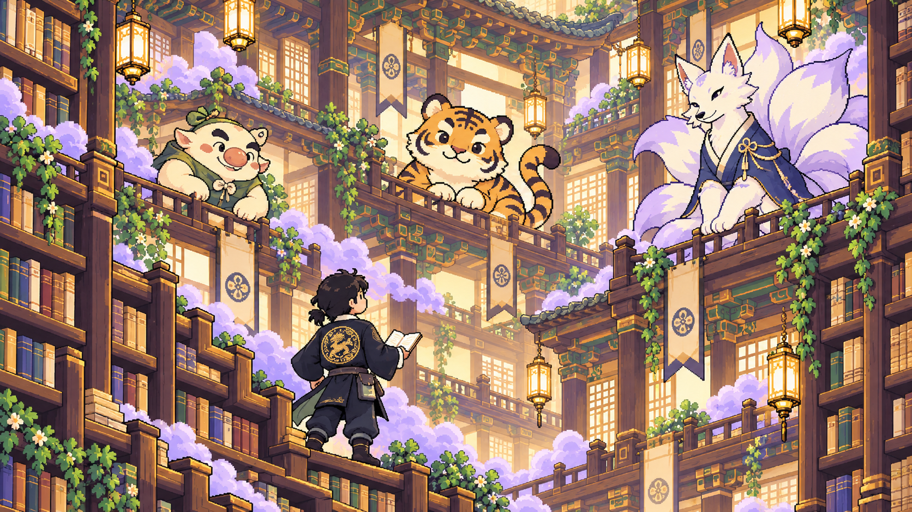
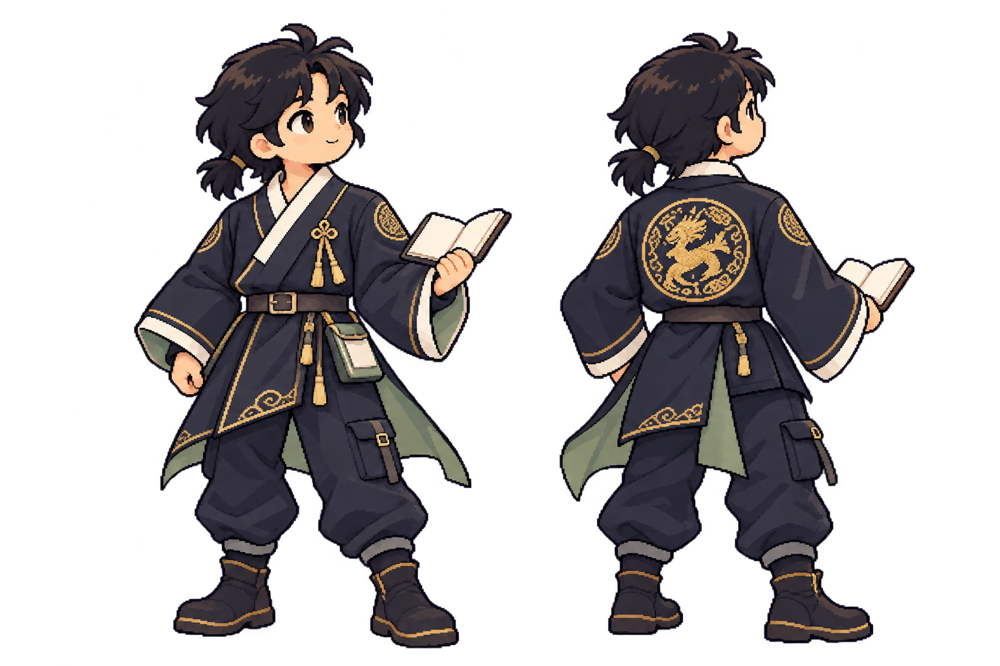

# 한국풍 서고탑과 문무 탐험가 — 아트 수정안

2026-10-21 · 사용자가 선택한 한국풍 키 아트·주인공 복식 방향. 기존 탑 구조·세밀한 도트·현재 캐릭터 디자인을 유지하고 [부적패·호리병 봉인](부적패와-호리병-봉인.md)으로 도구를 잇는다.
고려·조선의 분위기와 현대 복식을 섞은 창작 판타지다. 특정 시대의 복식·건축을 그대로 복원한 설정은 아니다.
전체 이야기 기준은 [왕명과 닫힌궁](../스토리.md)이다. 왕명을 받은 ‘나’가 헛소문으로 나라를 어지럽히는 요괴를 봉인하고, 사람들이 글을 읽고 판단하는 ‘글힘’을 되찾도록 돕는다.

## 방향

밝은 종이 도서관은 평소 문이 잠긴 **닫힌궁 안의 한지·목조 서고탑**이다. 화제별 3층 구조, 책장 계단·위층 난간·세 요괴의 위치·아래에서 위를 바라보는 주인공은 유지한다.
무드: 한지의 온기 · 먹빛 윤곽 · 민화의 익살 · 장수의 침착함 · 현대적인 실용성.
세밀한 도트·단계별 단색 음영을 사용한다. 작은 32×32 격자로 되돌리지 않고 실제 표시 크기에서 형태와 문양을 알아볼 수 있게 한다.
읽는 면과 본문 가독성·Galmuri 글꼴·게임 기능·화면 배치 순서는 기존 명세를 따른다.

## 키 아트

| 요소 | 이번 수정 |
|---|---|
| 공간 | 둥근 석조 아치를 목조 기둥·보·창살·안쪽 처마·단청으로 바꾼다. 서가와 계단이 이어지는 깊이는 유지 |
| 종이·빛 | 크림색 한지 면, 따뜻한 등불, 세이지·금빛의 절제된 장식, 라벤더색 안개 |
| 주인공 | 왕명을 받은 검은 머리의 이름 없는 ‘나’. 문무를 겸비한 장수의 침착한 자세에 현대 한복·테크웨어의 실용성을 더함 |
| 등판 | 먹빛 재킷의 등 중앙에 금빛 원형 용 문양. 실제 왕실 표장을 복사하지 않은 창작 장식 |
| 손과 장비 | 펼친 낱말 카드, 허리 카드 수납함·스트랩. 읽기와 근거 찾기가 행동의 중심 |
| 적 | 왼쪽 도깨비 → 가운데 호랑이 → 오른쪽 여우. 각 층의 서로 다른 실루엣과 친근한 표정 |

## 주인공 앞·뒤 복식

| 부분 | 디자인 |
|---|---|
| 머리 | 검은 머리를 낮게 묶는다. 모자 없이 얼굴 방향과 머리 실루엣이 드러남 |
| 상의 | 먹빛·짙은 남색의 겹깃 재킷, 크림색 깃, 넉넉한 소매, 활동하기 좋은 허리 여밈 |
| 뒷자락 | 비대칭으로 갈라진 옷자락과 세이지 안감. 등 위쪽에 크게 읽히는 원형 용 문양 |
| 테크웨어 | 카드 수납함, 버클·스트랩, 카고 주머니, 좁아지는 바짓단, 단정한 발목 신발 |
| 장식 | 원형 용 문양을 주 장식으로 삼고 금빛 선과 매듭은 보조로 사용. 가슴에 같은 큰 원형 문양을 반복하지 않음 |
| 게임 동작 | 부적패를 펼쳐 방어하고 근거를 가리킨다. 요약 성공 때 접힌 종이·안개를 호리병에 담고 도장으로 봉인 |

앞·뒤 그림은 복식 검토용으로, 실제 투명 RGBA PNG다. 배경의 알파 0 픽셀을 검사했다. 고정 셀의 게임용 스프라이트나 애니메이션 시트로 표시하지 않는다.

## 새 세계관의 요괴 세 종

| 층 | 새 외형 | 구분할 특징 |
|---|---|---|
| 1층 | 먹안개 도깨비 · `dokkaebi` | 둥근 코·굵은 눈썹·통통한 몸·세이지 조끼. 낱말을 흐리는 익살스러운 요괴 |
| 2층 | 뒤섞는 호랑이 · `tiger` | 민화풍 둥근 얼굴·황토빛 털·먹빛 줄무늬·휘어진 꼬리. 글의 앞뒤를 뒤섞는 요괴 |
| 3층 | 헛소문 여우 · `fox` | 크림색 털·라벤더 꼬리·먹빛 겹깃 옷. 참말 조각에 거짓을 보태 소문을 퍼뜨리는 우두머리 |

기존 ‘가뭄 도깨비·빈꽃 도깨비·지움 안개왕’은 이전 이름이다. 새 이름·id·대사는 스토리 4·6장으로 정리했으며 현재 그림의 한국풍 외형을 따른다.
실제 게임의 적 이름·id·대사·탑 문구는 후속 연결 대상이다. 현재 게임 데이터·전투 수치·꿀벌 정보글은 바꾸지 않았다.
학생이 봉인하는 대상은 여전히 낱말을 가리는 허구의 안개다. 실제 호랑이·여우를 해치는 이야기로 바꾸지 않는다.

## 파일과 검증

- [키 아트 PNG](concept/key-art-v4-korean.png) · [실제 생성 프롬프트](concept/key-art-v4-korean.prompt.txt): 1672×941 RGB.
- [주인공 PNG](concept/reader-korean-concept.png) · [실제 생성 프롬프트](concept/reader-korean-concept.prompt.txt): 1536×1024 RGBA.
- 기본 image_gen으로 각각 제작했고 생성 결과를 그대로 복사했다. 이미지 편집 스크립트·리사이즈·색 보정은 사용하지 않았다.
- [검사 기록](concept/korean-art-audit.json): PNG 크기·색 모드·투명 알파·프롬프트 짝을 확인한다.
- 기존 키 아트 v3와 v1 스프라이트는 비교용으로 보존한다. 게임의 엔진·화면 코드는 수정하지 않았다.

검토할 것: 주인공 복식에서 장수의 느낌과 실용적인 옷의 균형, 원형 용 문양의 크기, 도깨비·호랑이·여우의 친근함.
